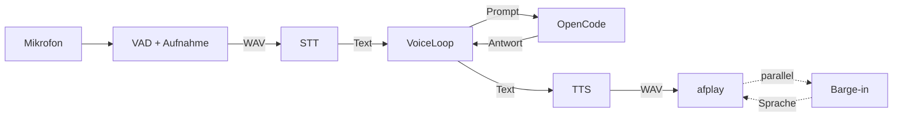

# VoiceBridge

**Sprich mit deiner OpenCode-Sitzung.** VoiceBridge nimmt dein Mikrofon auf,
transkribiert lokal oder im LAN, schickt den Text an OpenCode und liest die
Antwort vor – mit Barge-in, einem macOS-Cockpit und sichtbaren MCP-Diensten.


---

## Features

- **Sprachschleife:** Mikrofon → VAD → STT → OpenCode → TTS → Wiedergabe
- **Barge-in:** Unterbricht das Vorlesen, wenn du sprichst – ohne bei Rauschen
  abzubrechen (Umgebungspegel, Echo-Schätzung, 400-ms-Nachweis)
- **Cockpit:** WKWebView-UI mit Chat-Verlauf, Status-Orb, Modell- und
  Sitzungswahl, Pegel und Latenzen
- **MCP-Dienste sichtbar:** Status aller Server, per Klick ein-/ausschaltbar,
  damit sie den Kontext nicht fluten
- **Helfer-Leiste:** zeigt `scout`, `coder` und `voice-reviewer`, sobald der
  Orchestrator sie in dieser Sitzung startet – mit Status (läuft/fertig/fehler)
  und Ansage „Ich gebe das an den Scout."
- **Sitzungsgedächtnis:** letzte Sitzung fortsetzen oder eine alte wählen –
  inklusive der letzten 20 Züge im Chat
- **macOS-App:** Menüleisten-Launcher mit Mikrofon-Freigabe, baubar als
  `VoiceBridge.app`
- **Deutsch gedacht:** deutscher Agenten-Prompt, deutsche Stimme, deutsche UI

## Architektur



Details: [docs/ARCHITECTURE.md](docs/ARCHITECTURE.md)

## Voraussetzungen

- **macOS 11+** (AppKit, WebKit, `afplay`)
- **Python 3.9+**
- **OpenCode** mit laufendem Dienst (Desktop-App oder `opencode serve`)
- **STT/TTS** mit OpenAI-kompatibler API:
  - `POST /v1/audio/transcriptions` (multipart, Feld `file`)
  - `POST /v1/audio/speech` (JSON, Feld `input`, Antwort WAV)
- Optional: Homebrew-Pakete `portaudio` und `ffmpeg`

## Schnellstart

```sh
git clone https://github.com/benjamindamm/voice-bridge.git
cd voice-bridge

python3 -m venv .venv
source .venv/bin/activate
pip install -r requirements.txt

cp .env.example .env
# .env öffnen und STT/TTS-URLs sowie VOICE_API_KEY eintragen

# Agenten nach OpenCode installieren
mkdir -p ~/.config/opencode/agents
cp agents/*.md ~/.config/opencode/agents/

voicebridge --check
voicebridge --test-tts "Hallo, ich bin die Stimme."
voicebridge --test-record          # Mikrofon + STT
voicebridge --menubar              # Cockpit starten
```

Im Cockpit auf **Zuhören** drücken und sprechen. Ohne UI:

```sh
voicebridge --run                  # Sprachsitzung im Terminal, Ende mit Ctrl-C
```

### macOS-App

```sh
python scripts/build_app.py --venv .venv
open ~/Applications/VoiceBridge.app
```

Die App bringt die Mikrofon-Nutzungsbeschreibung mit und fragt beim ersten Start
nach der Freigabe. Log: `~/Library/Logs/VoiceBridge.log`.

## Bedienung

| Befehl | Zweck |
| --- | --- |
| `voicebridge --check` | Konfiguration und Abhängigkeiten prüfen |
| `voicebridge --warmup` | STT aufwärmen (erster Request kann ~2 min dauern) |
| `voicebridge --test-record` | eine Äußerung aufnehmen und transkribieren |
| `voicebridge --stt datei.wav` | vorhandene WAV transkribieren |
| `voicebridge --test-tts "Text"` | Sprechfassung und Wiedergabe testen |
| `voicebridge --play-wav datei.wav` | WAV abspielen (Player-Test) |
| `voicebridge --test-signal` | Denk-Ton 3 s abspielen |
| `voicebridge --ask "Text"` | Prompt ohne Sprache senden |
| `voicebridge --run` | Sprachsitzung im Terminal |
| `voicebridge --menubar` | Cockpit + Menüleiste |
| `voicebridge --new-session` | gespeicherte Sitzung ignorieren |
| `voicebridge --env PFAD` | alternative `.env` |
| `voicebridge --model PROVIDER/MODELL` | Modell für die Sitzung |
| `voicebridge --session ID` | bestehende Sitzung verwenden |

**Cockpit:** Chat mit Sprechblasen, Modell- und Sitzungswahl, Dienste-Chips,
Zuhören/Stoppen, Senden, Stopp, Mikrofon stumm, Stimme, Pegel und Latenz.
Details: [docs/TROUBLESHOOTING.md](docs/TROUBLESHOOTING.md).

## Konfiguration

Alle Schlüssel beginnen mit `VOICE_`, damit sie nicht mit Shell-Variablen
kollidieren. Umgebungsvariablen haben Vorrang vor `.env`;
`VOICE_BRIDGE_ENV` zeigt auf eine alternative Datei.

| Variable | Bedeutung |
| --- | --- |
| `VOICE_STT_URL`, `VOICE_TTS_URL` | Basis-URLs der Dienste (`…/v1`) |
| `VOICE_API_KEY` | Bearer-Token für beide Dienste |
| `VOICE_STT_MODEL`, `VOICE_STT_LANGUAGE` | STT-Modell und Sprache (`whisper-turbo`, `de`) |
| `VOICE_TTS_MODEL`, `VOICE_TTS_VOICE` | Piper-Modell und Stimme |
| `VOICE_TTS_MAX_CHARS` | Sprechgrenze der Antwort (Standard `350`) |
| `VOICE_ECHO_GUARD` | `strict` für Lautsprecher, `off` für Kopfhörer |
| `VOICE_PLAYER` | `afplay` oder `portaudio` |
| `VOICE_SESSION_DIR` | Arbeitsordner der Sitzung (Standard `~/voice-workspace`) |
| `VOICE_AGENT` | primärer Agent (Standard `voice-orchestrator`) |
| `VOICE_OPENCODE_URL`, `VOICE_OPENCODE_PASSWORD` | eigener OpenCode-Server; leer = automatisch |
| `VOICE_BARGE_*`, `VOICE_AMBIENT_MS`, `VOICE_RECORD_MIN_RMS` | Barge-in-Feintuning |
| `VOICE_VAD_*`, `VOICE_SILENCE_MS`, `VOICE_MIN_SPEECH_MS` | Aufnahme-Feintuning |

Die vollständige Liste mit Kommentaren steht in
[.env.example](.env.example).

Die Modellauswahl zeigt Modelle von Providern aus der OpenCode-Config
(`~/.config/opencode/opencode.json` unter `providers`) sowie von verbundenen
Integrationen (z. B. `opencode` Zen). Die Einträge sind nach Provider gruppiert;
kostenlose Modelle sind markiert.

## MCP und Dokumente

Das Cockpit listet alle MCP-Server mit Status. Ein Klick schaltet einen Server
in der OpenCode-Config aus oder ein (Backup:
`~/.config/opencode/opencode.json.bak-voicebridge`). Tool-Definitionen werden
beim Sitzungsstart geladen – danach **„Neue Sitzung"** starten.

Für PDFs, Word, Excel und PowerPoint empfiehlt sich
[`anymd`](https://www.npmjs.com/package/@sylphx/anymd):

```json
{
  "mcp": {
    "anymd": {
      "type": "local",
      "command": ["npx", "-y", "@sylphx/anymd"],
      "enabled": true
    }
  }
}
```

Details und Sicherheitshinweise: [docs/MCP.md](docs/MCP.md).

## Projektstruktur

```
voice-bridge/
├── voicebridge/              # Python-Paket
│   ├── assets/cockpit.html   # WKWebView-UI
│   ├── audio.py              # Aufnahme + VAD
│   ├── stt.py / tts.py       # API-Clients
│   ├── loop.py               # Zustandsmaschine
│   ├── menubar.py            # Menüleiste + Cockpit-Host
│   ├── opencode_client.py    # Session, Modelle, MCP, Verlauf
│   ├── opencode_config.py    # MCP-Schalter (V1/V2, Backup)
│   ├── events.py             # Narrator + Fortschritt
│   ├── sounds.py             # Denk-Ton
│   ├── speech.py             # Sprech-Normalisierer
│   ├── state.py              # Sitzung + Einstellungen
│   └── lock.py               # Instanz-Sperren
├── tests/                    # 77 Unit-Tests (unittest)
├── scripts/build_app.py      # VoiceBridge.app bauen
├── agents/                   # OpenCode-Prompts für den Sprachmodus
├── docs/                     # Architektur, MCP, Troubleshooting
├── .env.example
├── pyproject.toml
├── requirements.txt
└── README.md
```

## Entwicklung

```sh
python -m unittest discover -s tests -v
python -m compileall -q voicebridge
```

Die Tests laufen ohne Mikrofon, Netzwerk und OpenCode. Sie decken
Konfiguration, VAD-Zustandslogik, STT/TTS-Verträge, OpenCode-Client,
Zustandsmaschine, MCP-Schalter, Sperren und Sprech-Normalisierung ab.

## Grenzen

- **macOS-only:** AppKit, WebKit und `afplay`.
- **Vollbild-Space:** Das Cockpit kann nicht über dem Vollbild-Terminal einer
  anderen App liegen; Menüleiste oder Space-Wechsel nutzen.
- **Menüleisten-Name:** Der Python-Helfer erscheint als `Python`; App und Fenster
  heißen `VoiceBridge`.
- **Verlauf:** kommt live aus OpenCode; ältere Nachrichten können dort verdichtet
  werden.
- **Audio:** wird nicht dauerhaft gespeichert (außer `--test-record`).

## Sicherheit

- `.env` ist in `.gitignore` und wird nie committet.
- Der Orchestrator darf weder schreiben noch Shell ausführen; `coder`, `scout`
  und `voice-reviewer` haben getrennte, engere Rechte.
- MCP-Server laufen mit deinen Benutzerrechten. Nur vertrauenswürdige Server
  eintragen.

## Lizenz

[MIT](LICENSE) © 2026 Benjamin Damm
