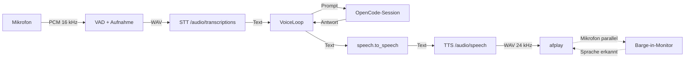

# Architektur

VoiceBridge ist ein schlanker Client: Es nimmt Sprache auf, schickt sie an
OpenAI-kompatible STT-/TTS-Dienste und benutzt eine OpenCode-Sitzung als
„Gehirn". Die Oberfläche ist ein WKWebView-Cockpit; die App läuft als
Menüleisten-Prozess.

## Ablauf



Ein Durchlauf:

1. `audio.record_utterance` schneidet eine Äußerung aus dem Mikrofonstrom
   (Vorlauf, Stille-Erkennung, 25-s-Cap).
2. `stt.transcribe` sendet die WAV-Datei an `POST /v1/audio/transcriptions`
   (Feld `file`, `model`, `language`, optional `prompt`).
3. `OpenCodeClient.ask` schreibt den Prompt in die Sitzung und pollt
   `/api/session/{id}/message`, bis eine `idle`-Nachricht erscheint.
4. `speech.to_speech` kürzt und normalisiert die Antwort fürs Vorlesen.
5. `tts.synthesize` sendet `POST /v1/audio/speech` (Feld `input`) und erhält
   rohe WAV-Bytes.
6. `tts.play_wav` spielt über `afplay`; parallel liest der Barge-in-Monitor das
   Mikrofon und bricht bei echter Sprache ab.

## Zustandsmaschine

`voicebridge/loop.py` kennt sieben Zustände:

| Zustand | Bedeutung | Auslöser |
| --- | --- | --- |
| `OFF` | bereit, kein Loop | Start/Ende |
| `MUTED` | Mikrofon freigegeben | Stumm-Schalter |
| `LISTENING` | Aufnahme läuft | Loop-Start, nach Antwort |
| `TRANSCRIBING` | STT läuft | Äußerung erkannt |
| `THINKING` | OpenCode arbeitet | Prompt gesendet |
| `SPEAKING` | TTS wird abgespielt | Antwort bereit |
| `ERROR` | Fehler, Loop endet | STT/OpenCode/Audio |

`Stopp` (`cancel`) setzt ein Abbruchsignal, stoppt Denk-Ton und Wiedergabe und
beendet nur die laufende Aufgabe. `Zuhören stoppen` (`stop`) beendet den Loop
und gibt das Mikrofon frei.

## Barge-in

Während der Wiedergabe liest ein eigener Thread das Mikrofon. Die Schwelle ist
bewusst konservativ, damit Rauschen die Antwort nicht abbricht:

- **Umgebungspegel:** Vor der Wiedergabe werden ~250 ms gemessen
  (`VOICE_AMBIENT_MS`). Das 75.-Perzentil × 1,6 bildet den Grundpegel.
- **Echo-Schätzung:** In den ersten 800 ms wird das Verhältnis Mikrofon/Echo
  gemessen; der Median dient als Gain. Fehlt die Messung, gilt 0,35.
- **Schwelle:**
  `max(Grundpegel, VOICE_BARGE_MIN_RMS, erwartetes Echo × Gain × VOICE_BARGE_FACTOR)`.
- **Nachweis:** Sprache muss `VOICE_BARGE_MS` (400 ms) durchgehend über der
  Schwelle liegen; der VAD läuft dabei mit `VOICE_BARGE_VAD` (2).
- **Nachlauf:** Nach der Wiedergabe wartet der Loop 250 ms, damit der
  Echo-Ausklang nicht als Sprache aufgenommen wird.

Jede Wiedergabe schreibt eine Diagnosezeile ins Log:

```
Barge-in: Boden 600 · Gain 0.04 · Spitze 1118 · Schwelle max 600 · 1900 ms
```

## Subagenten

Der Orchestrator darf `coder`, `scout` und `voice-reviewer` starten. VoiceBridge
verfolgt **nur Subagenten der eigenen Voice-Sitzung**; fremde Sitzungen werden
über die `sessionID` gefiltert.

Der Narrator liest dafür die SSE-Events:

| Event | Inhalt | Reaktion |
| --- | --- | --- |
| `session.tool.input.started` | `id`, `name` | Tool-Zuordnung |
| `session.tool.called` | `input.agent`, `input.description` | Helfer läuft, Ansage mit Namen |
| `session.tool.success` | `id` | Helfer fertig |
| `session.tool.error` / `failed` | `id` | Helfer fehlgeschlagen |
| `session.execution.failed` / `interrupted` | – | alle laufenden Helfer auf fehlgeschlagen |

Das Cockpit zeigt die drei Helfer als Chips (grau = bereit, orange = läuft,
grün = fertig, rot = Fehler). Zusätzlich erscheinen Zeilen im Transkript:

```
→ scout: README zweiter Satz
✓ scout fertig
```

Der Orchestrator arbeitet trotzdem oft selbst über das `execute`-Tool, statt zu
delegieren. Dann bleibt die Helfer-Leiste leer – das ist kein Fehler der
Anzeige, sondern eine Entscheidung des Modells. Ein klares „Nimm den Scout"
im Sprachbefehl hilft.

## Threads und Sperren

| Thread | Aufgabe |
| --- | --- |
| AppKit/Main | Menüleiste, WKWebView, Timer (0.3 s), UI-Updates |
| `voice-loop` | Aufnahme → STT → OpenCode → TTS |
| Narrator | Fortschrittsansagen und Denk-Schleife |
| Barge-in-Monitor | Mikrofon parallel zur Wiedergabe |
| Refresh | Sitzungen, Modelle und MCP-Status alle 10 s |

Netzwerk- und Audioarbeit läuft nie im UI-Thread. `cancel()` und `stop()` werden
aus Worker-Threads aufgerufen.

Sperren liegen unter `~/.local/state/voice-bridge/`:

- `loop.lock` – genau eine aktive Sprachsitzung
- `widget.lock` – genau eine Menüleisten-Instanz

Beide sind `flock`-Sperren und werden beim Prozessende automatisch freigegeben.

## Persistenz

| Datei | Inhalt |
| --- | --- |
| `~/.local/state/voice-bridge/session.json` | letzte Session-ID, Ordner, Agent |
| `~/.local/state/voice-bridge/settings.json` | Resume-Schalter, Modell |
| `~/Library/Logs/VoiceBridge.log` | Laufzeit-Log der App |
| `~/.config/opencode/opencode.json.bak-voicebridge` | Backup vor MCP-Änderungen |

Audio wird nicht dauerhaft gespeichert; `--test-record` legt bewusst eine
WAV-Datei im aktuellen Ordner ab.

## Grenzen

- **Whisper-Fenster:** ~28 s; die Bridge kappt bei 25 s
  (`VOICE_MAX_UTTERANCE_S`).
- **TTS:** Antworten werden bei `VOICE_TTS_MAX_CHARS` (350) gekürzt.
- **OpenCode:** Anfragen laufen in `VOICE_REQUEST_TIMEOUT_S` (120 s) ab.
- **macOS:** Ein Fenster kann nicht über den Vollbild-Space einer anderen App
  gelegt werden; das Cockpit bleibt auf dem Desktop-Space.
